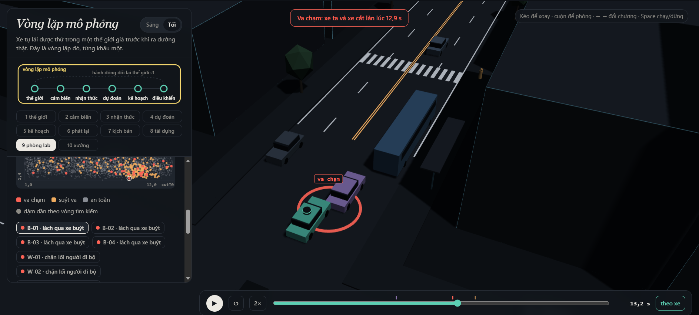
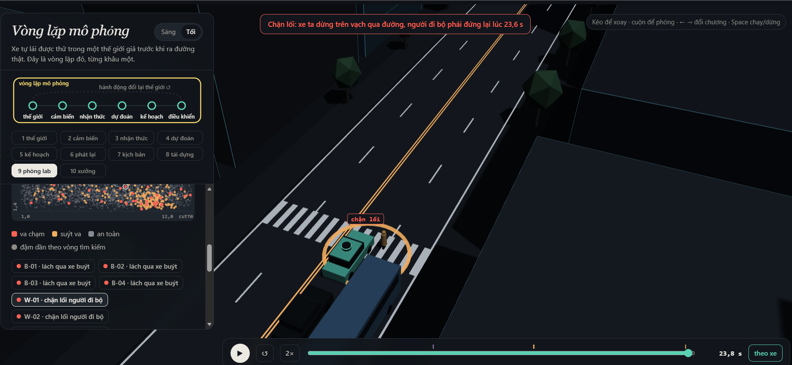

MSSV: 2A202602687

# Lab 11 · Scenario Forge — báo cáo

Họ tên: Nguyễn Khánh Đô. Thị trấn: C (meta.json: _run.town).

Số liệu lấy từ evidence/ ở ngân sách đầy đủ, không dùng --quick. Code đạt 31/31 test TODO và 41/41 test toàn bộ.

MSSV có chữ A nên khi chạy lại bằng PowerShell, đặt `$env:LAB11_MSSV="2A202602687"` trước lệnh `python -B run_all.py all` để giữ đúng seed.

## 1. Phát lại log

Nguồn: replay.json. Trong 400 kịch bản, loại 2 log người lái va chạm, còn 398 log.

| Cách chạy | Tổng thất bại | front | rear | side |
|---|---:|---:|---:|---:|
| Phát lại | 132 | 0 | 118 | 14 |
| Phản ứng | 1 | 1 | 0 | 0 |

Có 1 kịch bản thất bại ở cả hai cách. Xe phía sau trong log không phản ứng khi planner phanh sớm hơn người lái, tạo ra va chạm rear giả. Ví dụ replay_only[0]: scenario=1 va chạm rear khi phát lại, nhưng không thất bại trong thế giới phản ứng; min_ttc_reactive=2.50636 s.

## 2. Kịch bản bất khả thi

is_feasible áp dụng bốn giới hạn:

- Chuyển làn: cutDur>0 và (π/cutDur)²×3.5/2≤μg, bảo đảm đủ lực bám ngang.
- Phanh: cutBrake≤μg, không vượt lực bám mặt đường.
- Người đi bộ: pedV≤2.5 m/s, trong phạm vi mô hình đi bộ.
- Xe chuyển làn: 0<cutV≤22 m/s, trong miền tốc độ cho phép.

hunt.json: infeasible lần lượt là bus_bypass=3, cut_in=4, crosswalk_block=22, rear_ended=36. Cuộc săn rear_ended loại nhiều nhất. CEM ưu tiên nguy hiểm nên dễ tìm tới chuyển làn quá nhanh hoặc phanh quá mạnh; đếm các mẫu đó sẽ làm tăng giả rủi ro. Pipeline loại chúng trước mô phỏng.

## 3. Monte Carlo

mc.json: crashes=4, n=3000, p̂=0.00133333; Wilson 95% [0.000518617, 0.003423535]. Cả 4 thất bại thuộc bus_bypass.

Với mục tiêu sai số tương đối ±20%, ngân sách xấp xỉ n≈96/p≈72.000 lượt. Các kiểu cut_in, crosswalk_block, rear_ended và other chưa xuất hiện; mỗi kiểu có cận Wilson trên 0.001278896, không phải xác suất bằng 0.

## 4. Importance sampling

Nguồn: estimate.json: seeds[].per; mỗi kiểu mỗi seed có 600 mẫu.

| Seed | Kiểu | p̂ hoặc cận khi chưa thấy | hits | ESS | top_share |
|---|---|---:|---:|---:|---:|
| 0 | bus_bypass | 1.287209e-3 | 29 | 144.951 | 0.244282 |
| 0 | cut_in | chưa thấy; cận trên 0.025 | 0 | 122.801 | 0.000000 |
| 0 | crosswalk_block | 1.690200e-7 | 65 | 128.148 | 0.189443 |
| 0 | rear_ended | chưa thấy; cận trên 0.025 | 0 | 123.387 | 0.000000 |
| 1 | bus_bypass | 3.230657e-3 | 30 | 132.205 | 0.745984 |
| 1 | cut_in | chưa thấy; cận trên 0.025 | 0 | 115.650 | 0.000000 |
| 1 | crosswalk_block | 2.661260e-6 | 76 | 116.902 | 0.887873 |
| 1 | rear_ended | chưa thấy; cận trên 0.025 | 0 | 136.120 | 0.000000 |
| 2 | bus_bypass | 1.004437e-3 | 28 | 143.057 | 0.281562 |
| 2 | cut_in | chưa thấy; cận trên 0.025 | 0 | 137.226 | 0.000000 |
| 2 | crosswalk_block | 3.706685e-7 | 58 | 134.555 | 0.631952 |
| 2 | rear_ended | chưa thấy; cận trên 0.025 | 0 | 123.022 | 0.000000 |

Total của seed 0, 1, 2 lần lượt là 0.001287378; 0.003233318; 0.001004808. Trung vị 0.001287378 gần MC=0.001333333; các seed chênh tối đa 3.22 lần, riêng crosswalk_block chênh 15.75 lần.

ESS=(Σw)²/Σw² đo mức lệch trọng số. Top_share=max(wy)/Σ(wy) là phần đóng góp của mẫu lớn nhất. Seed 1 bus_bypass, seed 1 crosswalk_block và seed 2 crosswalk_block có top_share>0.5: một mẫu chi phối phần lớn kết quả. Top_share thấp vẫn không loại trừ bỏ sót vùng thất bại.

Budget=16.800 lượt, gồm 9.600 lượt săn và 7.200 lượt IS, chưa tính MC. Mốc 72.000 lượt MC cho mục tiêu ±20% lớn hơn 4.29 lần, nhưng IS hiện chưa đạt độ chính xác đó: 1.96se/p của bus_bypass qua ba seed là 0.714, 1.477 và 0.709. Để đạt sai số chuẩn như bus_bypass seed 0, MC cần khoảng 5.855 lượt theo công thức n≈p(1-p)/se².

Other lấy từ mc.json: k=0, n=3000, cận trên 0.001278896. Đây là phần dư không có mục tiêu săn riêng, vẫn được tính vào tổng. Cut_in và rear_ended chưa có hit: báo upper_zero_hits=3/(0.2×600)=0.025 cho từng kiểu, không dùng 3/ESS. Khoảng IS là xấp xỉ và nhạy với các mẫu trọng số lớn.

## 5. Các kiểu thất bại

Nguồn: hunt.json: found.

| Cuộc săn | bus_bypass tìm được | crosswalk_block tìm được |
|---|---:|---:|
| bus_bypass | 120 | 0 |
| cut_in | 32 | 0 |
| crosswalk_block | 6 | 28 |
| rear_ended | 2 | 0 |

Bus_bypass xảy ra khi C2 lách xe buýt và ego tiếp cận C2 đang chậm; nhãn yêu cầu x_C2<112 m, v_C2<6 m/s tại tiếp xúc. Crosswalk_block xảy ra khi ego dừng trên vạch, chắn P1 đang qua đường; sự kiện block cũng tính là thất bại.

Không tìm thấy cut_in/rear_ended không chứng minh xác suất bằng 0. Nhiều cuộc săn cùng tìm ra bus_bypass, cho thấy một cuộc săn chung dễ tập trung vào kiểu này; săn riêng giúp tìm thêm crosswalk_block.

Hai ảnh trên minh họa cơ chế từ bộ mẫu, không phải bằng chứng của lần chạy này. Các cảnh trong evidence/viewer.json tương ứng là B-01 (va chạm 12.35 s) và C-01 (chặn lối 20.50 s).

## 6. Sửa planner

fix.json chọn {"cutinLat":3.0} trên TRAIN, tăng ngưỡng nhận xe lấn làn từ 2.15 lên 3.0 m để ego phản ứng sớm hơn.

| Trường trong fix.json | fail | fail_hi | fail_hi_seen | progress (m) | harsh (khung/lượt) |
|---|---:|---:|---:|---:|---:|
| baseline_train | 1.93484181e-3 | 4.17271415e-3 | 4.17271415e-3 | 209.537423 | 9.175781 |
| chosen (TRAIN) | 1.54479146e-7 | 2.94035465e-7 | 2.94035465e-7 | 209.136919 | 8.859375 |
| baseline_test | 1.02741005e-3 | 3.20571499e-3 | 1.92681932e-3 | 210.941351 | 8.736333 |
| chosen_test | 1.28783447e-6 | 3.87815965e-2 | 2.70086889e-6 | 210.797739 | 7.993000 |

Ngưỡng tiến độ TRAIN là 199.060551 m. Ứng viên cutinLat=3.3 có cùng fail_hi nhưng đi ngắn hơn nên thua tiêu chí phụ. Cấu hình cutinLat=3.0,cautionV=6.5 không đạt ngưỡng tiến độ. TEST dùng seed mới và săn lại theo từng policy, không dùng để chọn lại.

Bản sửa giảm ước lượng thất bại TEST từ 1.02741e-3 xuống 1.28783e-6; quãng đường giảm 0.0681%, dưới giới hạn 5%. Harsh là số khung phanh dưới −3 m/s²; tiến độ chỉ tính đến lúc thất bại.

Không có hit bus_bypass trên TEST của bản sửa nên cận trên vẫn là 3/(0.2×400)=0.0375. Cộng cận crosswalk_block và các kiểu khác được fail_hi=0.0387816. Vì vậy kết quả điểm cải thiện rõ, nhưng chưa chứng nhận rủi ro rất nhỏ.

Giảm cautionV xuống 5.0 cho TRAIN fail=0.00211984, cao hơn baseline=0.00193484, và harsh tăng từ 9.17578 lên 13.41016. Đi chậm thay đổi khe chuyển làn và thời điểm tương tác của các tác nhân, nên không bảo đảm giảm thất bại.

Chạy lại B-01 xác nhận baseline va chạm C2 tại 12.35 s, còn bản sửa không có sự kiện ego. Ảnh so sánh đúng cảnh này chưa được bổ sung.

## 7. Từ mô phỏng ra đường thật

Ba giả định cần hiệu chỉnh bằng dữ liệu thực tế:

| Giả định | Dữ liệu cần thu thập | Hướng sai lệch |
|---|---|---|
| Khe chấp nhận chuyển làn | Video và quỹ đạo xe tại trạm xe buýt, đo khe lúc bắt đầu chuyển làn. | Khe thật nhỏ hơn có thể làm mô phỏng đánh giá thấp rủi ro. |
| Người đi bộ nhìn qua xe buýt | Video gán nhãn hành vi quan sát trước khi bước ra, theo mức che khuất. | Ít quan sát hơn có thể làm tăng nguy cơ băng ra trước xe. |
| Ma sát đường ướt | Thử phanh có kiểm soát trên tuyến khảo sát, ghi gia tốc, mặt đường và loại lốp. | Ma sát thấp hơn làm quãng phanh dài hơn; cần tính lại cả miền khả thi. |

## 8. Giới hạn

- Mô hình chỉ có một bố cục đường, không đại diện cho mọi tuyến và giao lộ.
- IDM và quy tắc chấp nhận khe chưa bao quát mất tập trung, phản ứng trễ và khác biệt giữa người lái.
- Cảm biến gần như hoàn hảo ngoài che khuất; chưa đánh giá sai số định vị và bỏ sót đối tượng.

Nếu có thêm một tuần, tôi sẽ thu thập quỹ đạo tại trạm xe buýt, hiệu chỉnh phân phối hành vi và kiểm tra độ nhạy với ma sát, độ trễ cảm biến trên tập đánh giá riêng.
